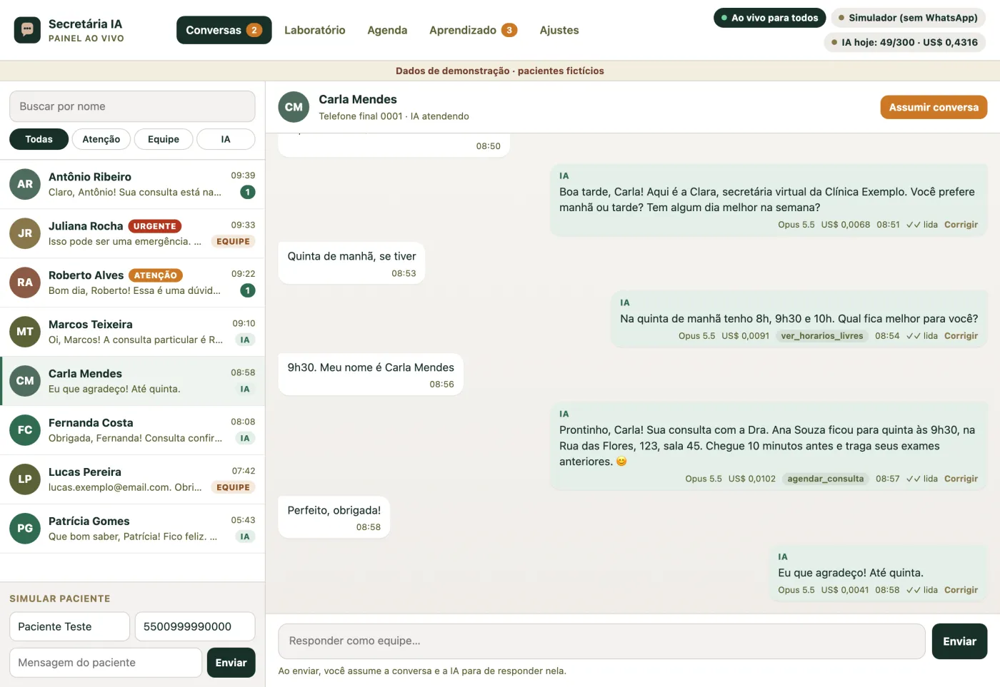

# Secretária de IA no WhatsApp

Uma secretária virtual para clínicas e consultórios: responde pacientes no WhatsApp,
marca, remarca e confirma consultas, tira dúvidas com base no que **você** aprovou e
passa para a equipe tudo o que não deve resolver sozinha. Você acompanha tudo ao vivo
num painel e assume qualquer conversa com um clique.



Feito pelo Dr. Júlio Andrade, da Comunidade IA para Médicos. O passo a passo completo,
com imagens, está em
**[comunidadeiamedicos.com/materiais/secretaria-ia](https://comunidadeiamedicos.com/materiais/secretaria-ia)**.

> Código de exemplo para estudo e adaptação. Antes de usar com pacientes reais, revise
> roteiro, base de conhecimento, segurança do servidor e as regras da LGPD (veja
> [docs/seguranca-lgpd.md](docs/seguranca-lgpd.md)).

## O que vem pronto

| Parte | O que faz |
| --- | --- |
| **Duas conexões** | API oficial da Meta (Cloud API) **ou** WAHA (não oficial, por QR code). Também um simulador, para testar sem WhatsApp. |
| **Painel ao vivo** | Conversas em tempo real, selos de atenção e urgência, botão **Assumir conversa** e **Devolver à IA**. |
| **Laboratório** | Converse com a IA como se fosse paciente. Usa a IA de verdade, mas nada sai para o WhatsApp. 20 cenários prontos e comparação entre modelos. |
| **Quatro fases** | Laboratório → só números de teste → ao vivo para todos → pausado. Você libera aos poucos. |
| **Agenda** | Horários livres, agendar, remarcar, cancelar e confirmar presença. A IA só agenda pela agenda. |
| **Automações** | Confirmação da consulta no dia anterior e mensagem de retorno alguns dias depois. |
| **Aprendizado revisado** | Correções da equipe e revisões feitas pela IA viram lições. Só entra nas instruções o que você aprovar. |
| **Proteções** | Emergência → orienta o 192 na hora; tentativas de mudar as regras são barradas sem gastar IA; dúvida clínica → equipe; limite diário de custo. |
| **Ritmo humano** | Espera o paciente terminar de escrever, marca como lida e mostra "digitando..." antes de responder. |

## Como funciona

```
Paciente no WhatsApp
      │
      ▼
Conexão: API oficial (Meta)  ou  WAHA (QR code)
      │  webhook
      ▼
Este servidor (Node.js) ──► Claude (Anthropic) + ferramentas da agenda
      │
      ▼
Painel ao vivo: a equipe vê tudo e assume quando quiser
```

## Começar em 5 minutos (sem WhatsApp)

Precisa de [Node.js 22](https://nodejs.org) ou mais novo.

```bash
git clone https://github.com/juliooandradee/secretaria-ia-whatsapp.git
cd secretaria-ia-whatsapp
npm install
cp .env.example .env        # troque PANEL_PASSWORD e coloque sua ANTHROPIC_API_KEY
npm run demo                # cria pacientes fictícios para você conhecer o painel
npm start
```

Abra `http://localhost:3000/painel` (usuário `equipe`, senha do `PANEL_PASSWORD`).
A chave da IA você cria em [platform.claude.com](https://platform.claude.com/settings/keys).

## O caminho que eu recomendo

1. **Atendimento humano primeiro.** Conecte o WhatsApp e deixe a equipe responder pelo painel, com a fase **Laboratório** (a IA não responde pacientes).
2. **Ensine a IA.** Edite `clinica/roteiro.md` (como atender) e `clinica/conhecimento.md` (só informação confirmada). Ajuste `clinica/agenda.json`.
3. **Escolha o modelo.** Comece pelo Claude Opus 5.5 (`AI_MODEL` no `.env` ou em **Ajustes** no painel). Cada resposta tem custo.
4. **Teste o modelo no laboratório.** Aba Laboratório no painel ou `npm run lab` para rodar os 20 cenários. Depois, `npm run lab:comparar` roda os mesmos cenários no Opus 5.5, no Sonnet 5.5 e no Haiku 5.5: se um mais barato acertar o que importa, troque. Corrija o roteiro e repita.
5. **Só o seu WhatsApp.** Fase **Só números de teste**, com o seu número na lista. Converse com ela pelo seu celular.
6. **Libere para todos.** Fase **Ao vivo**. Acompanhe pelo painel nos primeiros dias.
7. **Deixe aprender.** Corrija respostas pelo botão **Corrigir** e peça revisões em **Aprendizado**. Aprove só o que fizer sentido.
8. **Ligue as ações.** Em **Agenda**, ative a confirmação automática e o retorno.

## Conectar o WhatsApp

| | API oficial (Meta) | WAHA (não oficial) |
| --- | --- | --- |
| Como conecta | App na Meta + número verificado | Lê um QR code, como o WhatsApp Web |
| Estabilidade | Alta, dentro das regras da Meta | Pode desconectar; exige ajustes quando o WhatsApp muda |
| Risco ao número | Baixo | Existe risco de restrição. Use um número dedicado |
| Mensagens ativas | Só com modelos (templates) aprovados fora da janela de 24 h | Livres (com bom senso) |
| Custo | Cobrança da Meta por conversas iniciadas pela empresa | Servidor do WAHA |
| Guia | [docs/api-oficial.md](docs/api-oficial.md) | [docs/waha.md](docs/waha.md) |

No `.env`, escolha com `WHATSAPP_CHANNEL=oficial`, `waha` ou `simulado`.

## Escolher o modelo e o custo

| Modelo | Entrada | Saída | Leitura de cache | Quando usar |
| --- | ---: | ---: | ---: | --- |
| `claude-opus-5-5` | US$ 4 | US$ 20 | US$ 0,20 | Começo, casos difíceis, melhor qualidade |
| `claude-sonnet-5-5` | US$ 2 | US$ 10 | US$ 0,10 | Equilíbrio depois de testar no laboratório |
| `claude-haiku-5-5` | US$ 0,10 | US$ 0,50 | US$ 0,01 | Volume alto e respostas simples |

Preços por milhão de tokens, [tabela oficial](https://platform.claude.com/docs/en/about-claude/pricing)
conferida em 10/11/2026. O roteiro e a base ficam em cache (a parte fixa custa bem menos
a partir da segunda mensagem). O painel mostra o custo estimado de **cada** resposta e o
total do dia; o limite diário (`AI_DAILY_LIMIT`) protege contra surpresas. Para o Opus 5.5
e o Sonnet 5.5 o código liga o *fallback* do servidor da Anthropic: se o filtro de
segurança recusar uma resposta, a própria API tenta outro modelo.

**Teste antes de trocar.** `npm run lab:comparar` roda os mesmos cenários nos três modelos e
mostra, lado a lado, quantos passaram sem alerta e quanto custou cada teste. Para um modelo
só: `npm run lab -- --modelo claude-haiku-5-5`. Nada sai para o WhatsApp e o modelo do
atendimento não muda.

## Estrutura

```
clinica/            o que a clínica edita: roteiro, base de conhecimento e agenda
lab/scenarios.json  os 20 cenários do laboratório
public/             o painel (HTML, CSS e JS, sem framework)
src/
  assistant.js      quem responde (IA ou equipe), proteções e ritmo
  brain.js          chamada ao Claude e ferramentas
  tools.js          ferramentas da agenda e "chamar humano"
  channels/         API oficial, WAHA e simulador
  learning.js       lições a partir das conversas (com aprovação)
  scheduler.js      confirmação e retorno automáticos
  http/             painel, webhooks e senha
scripts/            demo e laboratório pela linha de comando
test/               testes automatizados (node --test)
docs/               guias de conexão, deploy e LGPD
```

Os dados ficam em `data/db.json` (um arquivo, fácil de copiar). Para muito volume,
troque por PostgreSQL mantendo as mesmas funções.

## Comandos

| Comando | Para quê |
| --- | --- |
| `npm start` | Sobe o servidor e o painel |
| `npm run dev` | Igual, reiniciando quando você edita o código |
| `npm run demo` | Cria dados fictícios para conhecer o painel |
| `npm run lab` | Roda os 20 cenários com a IA de verdade e mostra o custo |
| `npm run lab:comparar` | Roda os mesmos cenários no Opus 5.5, no Sonnet 5.5 e no Haiku 5.5 e compara |
| `npm run lab -- --modelo claude-haiku-5-5` | Testa um modelo sem mudar o `.env` |
| `npm test` | Testes automatizados (não gastam IA nem enviam mensagens) |

## Colocar no ar

Qualquer servidor com Node.js 22 e disco persistente serve. Passo a passo para Railway,
Render e VPS em [docs/deploy.md](docs/deploy.md). Há `Dockerfile` e `docker-compose.yml`
(este já sobe junto o WAHA, se você escolher a conexão não oficial).

## Segurança e LGPD

- O painel exige senha; webhooks da Meta são conferidos pela assinatura e os do WAHA por um segredo.
- A IA não diagnostica, não interpreta exames e não indica remédios: passa para a equipe.
- Sinais de emergência recebem orientação imediata para ligar 192 e a conversa vai para a equipe.
- Envio sem confirmação do WhatsApp fica "incerto" e **nunca** é repetido sozinho.
- Leia [docs/seguranca-lgpd.md](docs/seguranca-lgpd.md) antes de ir ao ar.

## Licença

MIT. Use, adapte e compartilhe. Se melhorar algo, conta para a gente na comunidade.
